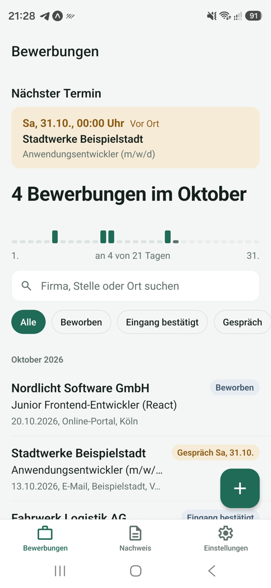
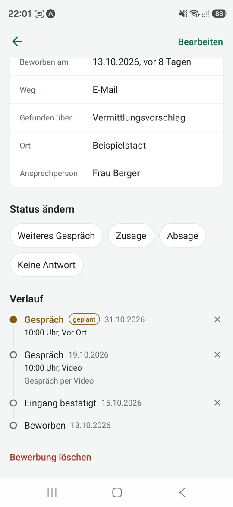
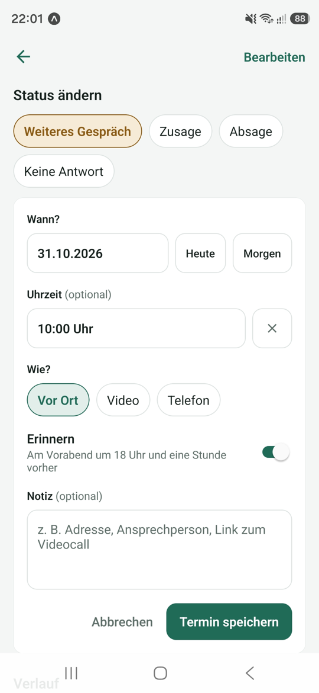
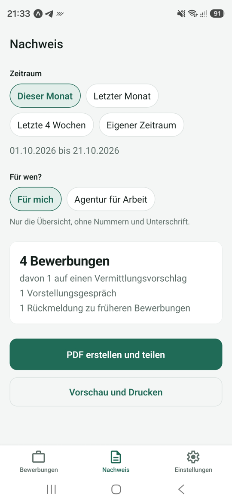
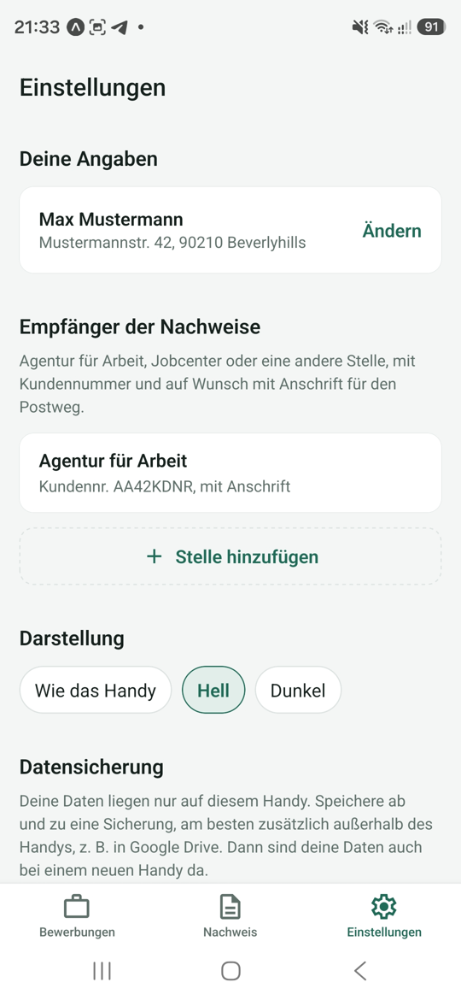
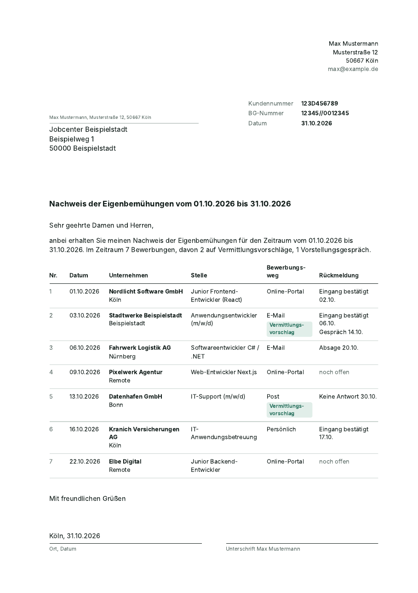

<p align="center">
  
</p>

<h1 align="center">Jobspur</h1>

<p align="center">
  <strong>Deine Jobsuche im Griff.</strong><br>
  Bewerbungen festhalten, Rückmeldungen und Gespräche verfolgen und den<br>
  Nachweis der Eigenbemühungen für Agentur für Arbeit oder Jobcenter als PDF erstellen.
</p>

<p align="center">
  <a href="https://github.com/anatolij-imgrund/Jobspur/actions/workflows/ci.yml"></a>
  
  
  
  
</p>

---

## Worum es geht

Wer arbeitssuchend gemeldet ist, muss seine Bewerbungen nachweisen: Datum,
Unternehmen, Stelle, Bewerbungsweg und Rückmeldung. Vor jedem Termin heißt
das bisher Zettel, Excel-Listen und E-Mail-Postfach durchsuchen.

Jobspur sammelt alles an einem Ort, während man sich bewirbt, und macht daraus
auf Knopfdruck einen ordentlichen Nachweis. Als Brief mit Anschrift für den
Fensterumschlag, mit Kundennummer und Unterschriftszeile, oder einfach als
Übersicht für einen selbst.

Allgemeine Bewerbungs-Tracker gibt es viele, meist auf Englisch und ohne
diesen Nachweis. Jobspur ist für die Jobsuche in Deutschland gebaut.

## Screenshots

<p align="center">
  
  
  
  
  
</p>

## Funktionen

**Bewerbungen und Verlauf**
- Bewerbung in Sekunden eintragen: Firma, Stelle, Datum, Bewerbungsweg und ob
  es ein Vermittlungsvorschlag war
- Jede Rückmeldung als Eintrag im Verlauf: Eingang bestätigt, Gespräch,
  Zusage, Absage, keine Antwort
- Nur sinnvolle Übergänge; nach Absage oder Zusage ist die Bewerbung abgeschlossen
- Hinweis „seit 23 Tagen ohne Antwort“ als Anlass zum Nachfassen
- Monatsstreifen: Wie viele Bewerbungen an wie vielen Tagen dieses Monats?

**Gesprächstermine**
- Termine mit Uhrzeit und Art (vor Ort, Video, Telefon), auch Zweitgespräche
- Erinnerung am Vorabend und eine Stunde vorher; Antippen öffnet die Bewerbung
- „Nächste Termine“ oben in der Übersicht
- Kommt vor dem Termin eine Absage, wird er samt Erinnerung entfernt

**Nachweis der Eigenbemühungen**
- Zeitraum wählen, Empfänger wählen, als PDF teilen oder drucken
- Mit Anschrift als Brief nach DIN 5008 Form B für Fensterumschläge
- Kundennummer, beim Jobcenter auch BG-Nummer, Ansprechperson
- Rückmeldungen im Zeitraum zu früheren Bewerbungen in eigenem Abschnitt,
  geplante Gespräche als „geplant“ gekennzeichnet

**Datensicherung**
- Ohne Internet in einen Ordner auf dem Handy oder über Google Drive, E-Mail …
- Wiederherstellen mit vollständiger Prüfung der Datei vorher
- Erinnerungen für kommende Gespräche werden danach neu eingerichtet

**Darstellung**
- Hell, dunkel oder wie das Handy eingestellt

<details>
<summary><strong>Beispiel: Nachweis als Brief</strong> (erfundene Daten)</summary>
<p align="center"></p>
</details>

## Datenschutz

Alle Daten bleiben auf dem Handy. Jobspur hat **kein Konto, keinen Server,
kein Tracking und keine Werbung**. Die einzige Berechtigung, die die App
erfragt, ist die für Benachrichtigungen, und auch die nur, wenn man eine
Erinnerung an ein Gespräch möchte.

Eine Sicherung verlässt das Handy nur, wenn man sie selbst teilt.

## Technik

| Bereich | Umsetzung |
| --- | --- |
| Plattform | React Native 0.86 mit Expo SDK 57, React 19.2, React Compiler |
| Sprache | TypeScript im Strict-Modus |
| Navigation | Expo Router (dateibasiert, Tabs und Modals) |
| Daten | SQLite über `expo-sqlite`, versionierte Migrationen |
| Formulare | `react-hook-form` mit `zod`, Meldungen auf Deutsch |
| PDF | HTML-Vorlage, gerendert mit `expo-print`, geteilt mit `expo-sharing` |
| Erinnerungen | lokale Benachrichtigungen mit `expo-notifications` |
| Dateien | `expo-file-system` (Ordnerzugriff über das Android-Speicher-Framework) |
| Qualität | `node:test` gegen echtes SQLite, ESLint typgestützt, GitHub Actions |

## Architektur

```
src/
├── app/          Bildschirme (Expo Router); bleiben schlank
├── components/   wiederverwendbare Bausteine, Formularfelder
├── db/           Schema, Migrationen, alle SQL-Abfragen
├── features/     Logik je Funktion: Formular, Detail, Nachweis,
│                 Erinnerungen, Sicherung, Einstellungen
├── hooks/        kleine React-Hooks
├── lib/          Datum, Benachrichtigungen, Hilfsfunktionen
├── theme/        Farben hell/dunkel, Abstände, Schrift
└── types/        Datenmodell und Beschriftungen
tests/            Tests gegen echtes SQLite
assets/source/    SVG-Quellen von Icon und Bildmarke
```

Einige Entscheidungen, die das Projekt prägen:

- **Der Verlauf ist die Wahrheit.** Der aktuelle Status einer Bewerbung wird
  immer aus ihrem jüngsten Verlaufseintrag abgeleitet, auch beim
  Wiederherstellen einer Sicherung. So können Status und Verlauf nicht
  auseinanderlaufen.
- **Migrationen ganz oder gar nicht.** Jede Schemaversion läuft in einer
  eigenen Transaktion. Bricht die App mittendrin ab, bleibt die Datenbank auf
  der letzten vollständigen Version.
- **Alles von außen ist unzuverlässig.** SQL nur mit Parametern, Texte im PDF
  werden maskiert, Sicherungsdateien vor dem Einlesen vollständig mit `zod`
  geprüft (Typen, Längen, Obergrenzen, logische Konsistenz). Ein Test spielt
  präparierte Dateien mit SQL-Injection, Skripten und Riesentexten durch.
- **Logik ohne Handy testbar.** Erinnerungszeiten, PDF-Vorlage und alle
  Datenbankfunktionen sind reine Funktionen oder laufen gegen das in Node
  eingebaute SQLite.
- **Fehler werden nicht verschluckt.** ESLint verbietet Promises ohne `await`
  (`no-floating-promises`). Ein Problem beim Einrichten einer Erinnerung lässt
  das Speichern eines Termins nie scheitern.

## Selbst ausprobieren

Voraussetzungen: Node.js 22.13 oder neuer, ein Android-Handy mit
[Expo Go](https://expo.dev/go) oder ein Emulator aus Android Studio.

```bash
git clone https://github.com/anatolij-imgrund/Jobspur.git
cd Jobspur
npm install
npx expo start
```

QR-Code mit Expo Go scannen. Auf der leeren Übersicht füllt
„Beispieldaten einfügen“ die App mit erfundenen Bewerbungen (nur im
Entwicklungsmodus).

```bash
npm test            # Tests
npm run typecheck   # TypeScript
npm run lint        # ESLint
```

> In Expo Go auf Android kann die App keinen eigenen Benachrichtigungskanal
> anlegen und nutzt den Standardkanal; Erinnerungen kommen trotzdem an. Icon
> und Startbildschirm sind erst in einem echten Build zu sehen.

### App bauen

Gebaut wird in der Cloud mit [EAS Build](https://docs.expo.dev/build/introduction/),
der Ordner `android/` entsteht dabei automatisch aus `app.json`.

```bash
npx eas-cli@latest build -p android --profile preview      # APK zum Installieren
npx eas-cli@latest build -p android --profile production   # App Bundle für Google Play
```

## Pläne

- [ ] Veröffentlichung im Google Play Store
- [ ] Erinnerung zum Nachfassen, wenn eine Bewerbung lange ohne Antwort bleibt
- [ ] Monatsziel aus dem Kooperationsplan mit Fortschritt
- [ ] Statistiken: Bewerbungen pro Monat, Antwortquote
- [ ] Stellenanzeige als Link oder Foto übernehmen

## Über das Projekt

Jobspur ist mein eigenes Projekt nach der Ausbildung zum Fachinformatiker für
Anwendungsentwicklung, entstanden aus der eigenen Jobsuche. Entwickelt habe
ich es mit Claude (Anthropic) als Pair-Programming-Partner. Idee, Funktionen,
Entscheidungen und das Testen auf dem echten Gerät liegen bei mir; daher die
Zeile `Co-Authored-By` in den Commits.

**Anatolij Imgrund** · [GitHub](https://github.com/anatolij-imgrund)

## Lizenz

Alle Rechte vorbehalten. Der Code ist zum Ansehen öffentlich, aber nicht zur
Weiterverwendung freigegeben. Details in [LICENSE](LICENSE).
